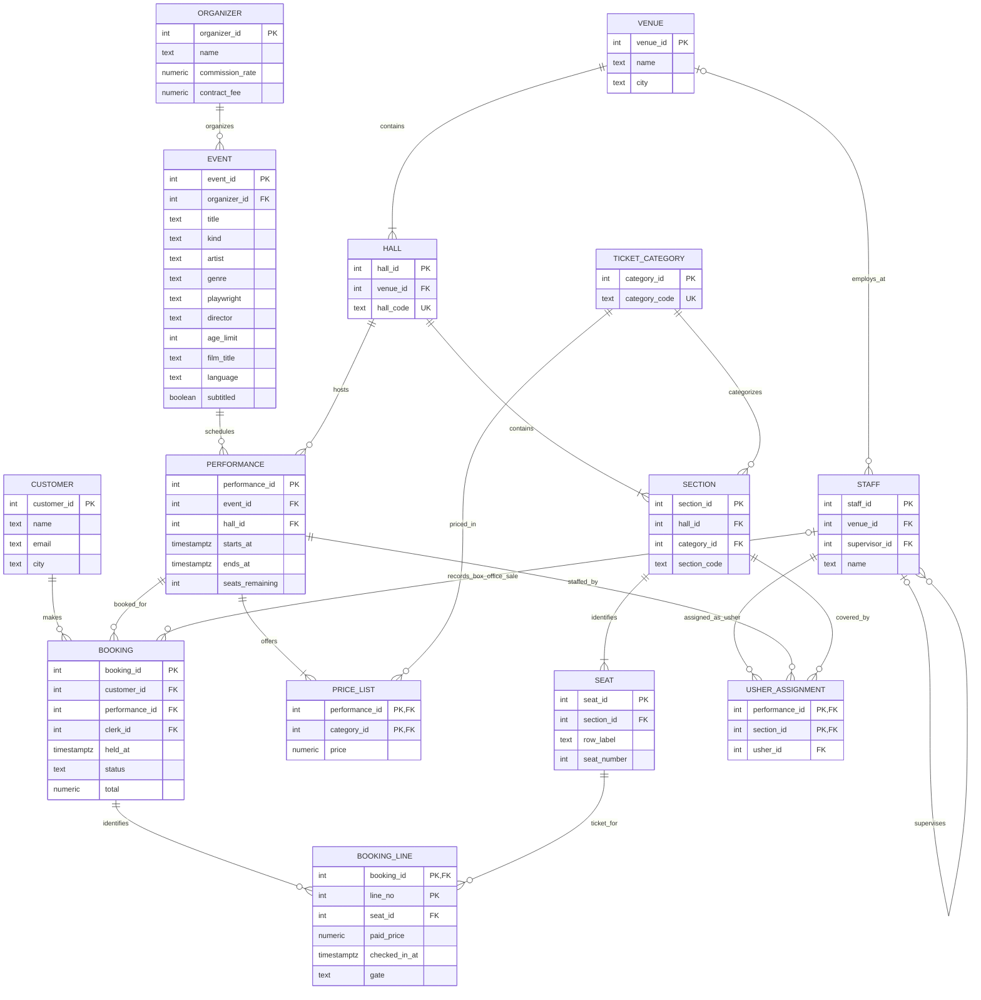

# ER diagram v1 — core draft

This **unfinished core model has 14 entity types**. It replaces the first speculative diagram after reading S4's catalog. The complete model still needs seat state/history, promotions/redemptions, payments/refunds, and auditing. Having 14 entities does not make this ready for M1.

Notation: `||` = exactly one / total; `o|` = zero or one / partial; `|{` = one or many / total; `o{` = zero or many / partial. Minima below include draft assumptions that need review. Types are illustrative.

## Required modelling cases

- **Weak entity:** `BOOKING_LINE` is identified by its owner booking plus `line_no`. It cannot exist without its booking. `SEAT` also has the natural identifying key `(section_id, row_label, seat_number)`; the draft retains a surrogate `seat_id` because required procedures take integer seat IDs. The natural key requires a UNIQUE constraint.
- **M:N with attributes:** performance–ticket category through `PRICE_LIST` has `price`. Staff–performance through `USHER_ASSIGNMENT` has `section_id`. Its proposed key is `(performance_id, section_id)`, assuming one usher per performance/section. Review live assignment rules separately from historical B3.
- **Recursive:** staff–supervisor, with zero or one supervisor and zero or many reports. Prevent self-supervision/cycles if this hierarchy assumption is retained.
- **Specialization:** events have exactly one kind: concert, theatre, or cinema. Start with one `EVENT` table and type-specific nullable columns. This simplifies the core model but requires CHECK constraints to require applicable fields and reject inapplicable fields. Subtype tables would reduce nulls and group type-specific attributes but add tables and joins. Full type constraints remain to be designed.

## Further constraints and work

- A booking's lines must refer to seats in its performance's hall. Seat availability is per performance, not a global `SEAT` attribute.
- Held bookings can be assembled without lines; confirmation requires at least one. Performance price lists must cover every category used in the hall, stronger than the diagram's one-or-many rows.
- Clerk participation is optional for online bookings; staff venue participation is optional for head-office staff. Document creation-time participation policies for halls, sections, seats, and performances.
- Add required `ticket.promo_code`, `ticket.seat_status_history`, and `ticket.audit_log`, plus current seat state, redemptions, payments and refunds, with keys and participation.
- Review alternate keys, including hall codes and section codes within halls. Do not automatically import historical exercise FDs into the live model.
- Verify every relationship end and required name, then export readable `docs/ER.pdf`. No PDF exists yet.
